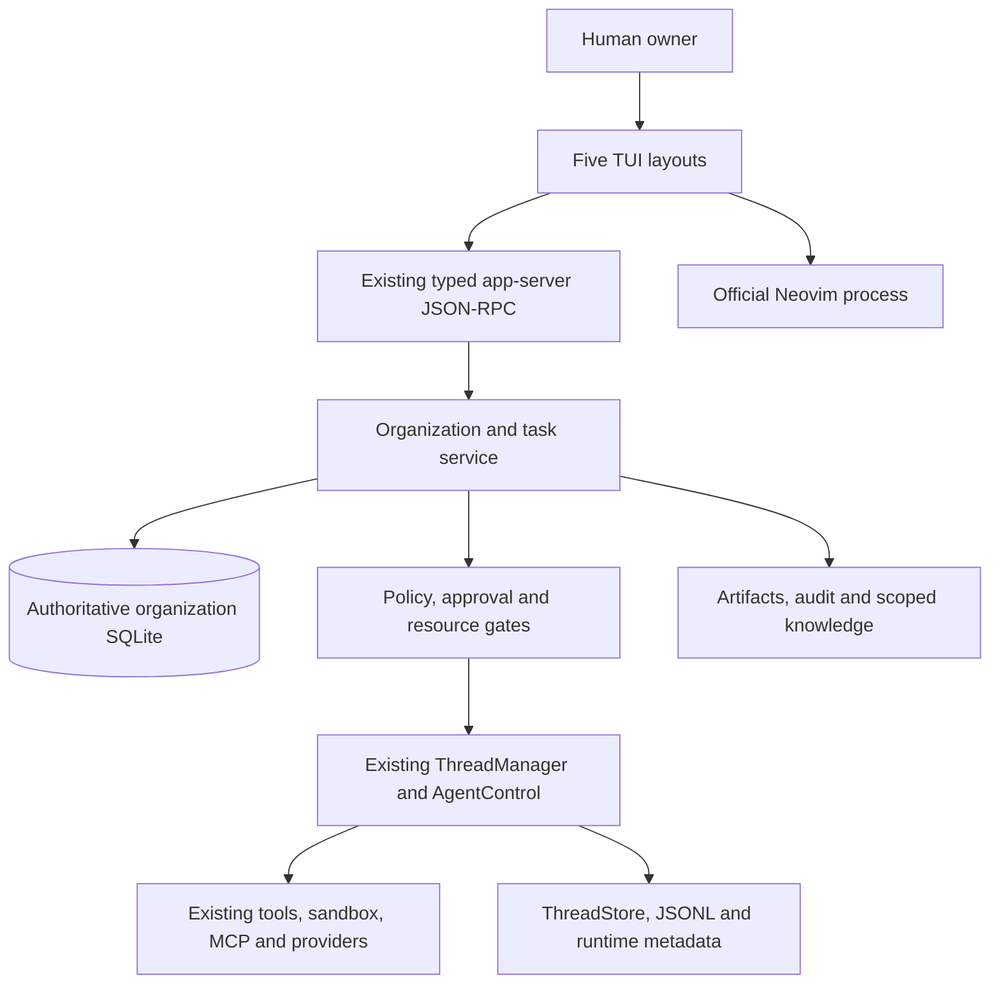

# Recommended architecture

Product choices are **proposed**, pending MVP scope approval. CLI/daemon/editor
foundations have been qualified; see [qualification](qualification.md).

## One daemon, several responsibilities

Extend the existing Codex app-server daemon with an organization/task service.
Use one local host, one owner, and bounded execution concurrency first.
The TUI is a client; editor and terminal processes are UI components.
Closing them must not own or cancel durable background tasks.

Use existing extension contributors for thread/turn/tool lifecycle observation
and context injection where they fit. Add a small app-server-owned service for
organization commands, scheduling and durable state. A new crate is justified
only if actual app-server/core dependency boundaries require it; do not prebuild
a plugin framework, actor framework, worker abstraction hierarchy, or microservices.

The existing AgentControl trait controls one execution tree. Durable organization
nodes may map to different execution trees/threads over time. Do not retrofit
all organizational state into AgentPath or retain an entire organization in one
prompt. Preserve ThreadId as execution identity and use stable separate AgentId.

## Storage ownership

Use a dedicated authoritative SQLite database, provisionally
`<sqlite_home>/organization.sqlite`, through existing SQLx/migration infrastructure.
It contains definitions, tasks, claims, approvals, budget reservations, action
intents, evidence references, durable inbox entries and client events.
Use foreign keys, short transactions, bounded busy timeouts and WAL where the
filesystem supports it. For authoritative commits choose FULL synchronization;
benchmark the cost rather than inheriting runtime Normal durability silently.

**Do not automatically discard/rebuild this database on corruption.** Preserve
files, enter restricted recovery, and require verified restore/reconciliation.
Codex's thread metadata and JSONL history retain their current ownership.

Existing project IDs, names and roots remain usable. Store planning/organization
extensions keyed by those IDs. Because stores are separate, references cannot
be enforced by an ordinary cross-database foreign key. For project creation:
record an idempotent intent, call existing project/create, record the returned ID,
and repair unfinished intents on restart. Keep a captured project descriptor
for recovery and flag missing/mismatched upstream projects. Do not claim that
two databases and JSONL are one atomic transaction.

All coupled business changes—claim, reservation, transition, action intent,
audit entry and outgoing notification—commit in the organization DB together.
An event/outbox table provides client replay and pending dispatch. It is not
a full event-sourcing platform; queryable rows remain authoritative.

## Organization and autonomy

Users define role labels/instructions, parent/group structure, memberships,
projects and explicit grants. No mandatory CEO, director, manager, worker,
shared-function agents, or fixed depth exists. A single agent is sufficient.
Optional templates make large setups convenient.

A primary acyclic forest supports the Operations tree. Extra memberships or
coordination links support functional/project organization without turning
authority into an ambiguous multiple-parent inheritance graph.
Reparenting and role edits are versioned and audited. User-defined labels do not
grant administrator powers. Delegation carries task scope and policy ceilings;
authority never increases merely because a node moved.

AI planning proposes goals/tasks, assignments and workflow changes through
validated commands. Deterministic code checks identifiers, ownership, graph
cycles, policy, quotas and acceptance transitions. The planner can make routine
authorized decisions; protected mission changes and authority expansion remain
owner-controlled.

## Scheduling and execution

1. Wake on committed task/dependency/message changes and the next due deadline.
   Use Tokio channels/Notify for hints plus a bounded timer as recovery fallback.
2. Select runnable tasks fairly across projects, respecting priority, dependencies,
   not-before time, pause state and available budgets/resources.
3. In one transaction claim a task, allocate an attempt/lease generation, reserve
   capacity and budget, and record the start intent.
4. Start or resume the existing Codex thread with captured role version, task
   context, environment, tools and permissions. Save thread/turn correlation.
5. Renew the lease and record useful checkpoints, events and actual usage.
6. On output, validate artifacts and criteria. Final results require owner review;
   internal tasks may use explicit preauthorized machine-checkable acceptance.
   Persist the evidence and accepting actor/policy. An agent's “done” message
   alone never completes a task.
7. Release settled reservations and wake dependents only after acceptance.

Use a small configurable concurrency cap (suggested initial 2, qualification
at 4), not a process/model call per registered agent. Existing V2 execution and
residency limits also apply. Admission must cover direct turns, delegated turns,
automatic continuations, mailbox wakeups and resumed work. The shutdown-only
TurnStartAdmission gate explicitly has bypasses; it is not sufficient alone.

Task claims use owner/generation/expiry and compare-and-swap transitions.
No network/provider request occurs while holding a SQLite transaction.
Do not hold one executor slot while an agent waits for human approval or for
child work: checkpoint/yield, release capacity, then reacquire to continue.
This prevents an organization of waiting supervisors from starving its workers.

Initial scheduling supports runnable dependencies and one-shot due time.
Recurring/calendar rules, meetings and a workflow designer arrive later with
timezone, DST, misfire and cancellation semantics explicitly specified.

## Communication, memory and recovery

Use existing AgentControl delivery within live execution trees. For task-critical
cross-session messages, persist an authenticated inbox/outbox entry before
delivery; record a message ID and deduplicate retries. Accepted, delivered,
processed and task-acknowledged are distinct states. Do not assume the existing
in-memory mailbox survives process loss.

Reuse the existing message board for discussions when session identity and
access semantics fit. A stable organization board mapping and ACL adapter are
needed before broad cross-project use. Avoid creating an always-running meeting
agent or broadcasting all events to all agents.

Keep canonical state out of memory summaries. Scoped notes/knowledge references
record agent/project/team/workspace scope, provenance, version, sensitivity,
confidence and freshness. Retrieve with enforced ACL filters before ranking,
then fit selected content into context budgets. Start with explicit notes,
metadata and text search; optional vector retrieval only when measured need
and privacy requirements justify it.

Resume task context from canonical state, last validated checkpoint, relevant
history and authorized knowledge. Do not replay an uncertain external action.
Failure and reconciliation details are in [security and recovery](security-and-recovery.md).

## Technologies: reuse first

| Need                  | Recommended choice                                      | Why / later trigger                                                                                      |
| --------------------- | ------------------------------------------------------- | -------------------------------------------------------------------------------------------------------- |
| Model/tool execution  | Existing Codex runtime and extension API                | Already integrated with policies and history                                                             |
| Background host       | Existing app-server daemon, later native OS supervision | One lifecycle; no second daemon                                                                          |
| Async coordination    | Existing Tokio/TaskTracker/cancellation                 | No actor framework needed                                                                                |
| Business persistence  | SQLite + existing SQLx patterns                         | Single-host transactional state; PostgreSQL only for measured contention/multi-host ownership needs      |
| Client protocol       | Typed existing JSON-RPC                                 | Preserve handshake, request IDs, schema tooling and clients                                              |
| UI                    | Existing Ratatui/Crossterm                              | Pane presets over reusable widgets                                                                       |
| Terminal              | Existing PTY + vt100                                    | Terminal pane; never pass arbitrary process escape bytes to the outer terminal                           |
| Editor                | Official Neovim external UI/RPC                         | Editing, motions, undo, highlighting, plugins remain Neovim's responsibility                             |
| Integrations          | Existing MCP, plugins, skills, provider config          | Start with allowed capabilities, not an agent-framework dependency                                       |
| File changes          | Existing Git/apply-patch/diff machinery                 | Capture expected versions and conflicts                                                                  |
| Observability         | Existing tracing/metrics plus audit records             | Audit is durable product data, not a metrics substitute                                                  |
| Distributed workflows | Defer Temporal, Redis, NATS, Kubernetes                 | Consider only after long-running multi-host requirements and benchmarks make SQLite service insufficient |

## Scale boundaries

Thousands of configured agents need cheap records, indexed lazy lookup and
paginated UI projections. Thousands of active agents require provider capacity,
host/process resources, rate limits and potentially multiple workers; that is
a later deployment architecture, not a default requirement to activate them all.

Use bounded queues, selective subscriptions, dirty-node aggregate updates and
visible-row rendering. Avoid cloning full transcripts and refreshing every node
per token. Measure CPU/memory at process or worker scope; do not display invented
per-agent CPU attribution when many agents share a process.

Initial qualification targets: 1 and 1,000 stored agents; 2–4 active runs;
deep configurable trees and cycle rejection. Larger synthetic registries test
UI/storage only, not autonomous effectiveness. Add process isolation or a remote
execution backend only when failure isolation or measured capacity warrants it.
